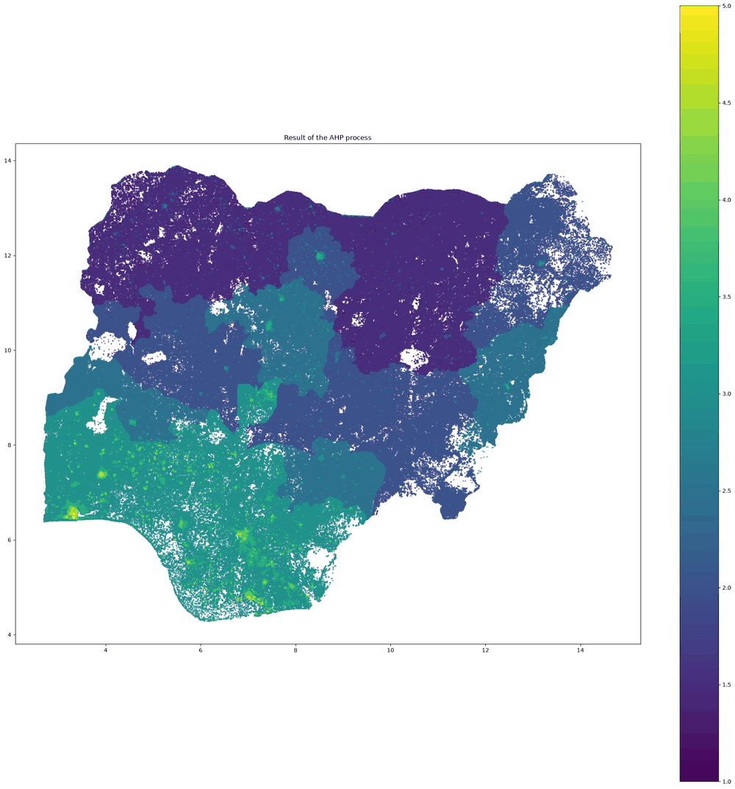
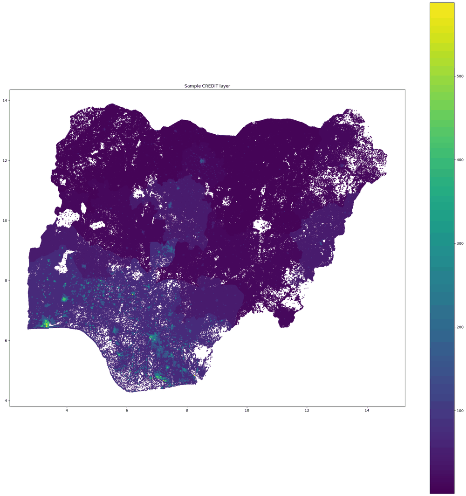

# CREDIT layer — Nigeria

**CREDIT** (Custom Residential Electricity Demand Indicative Target) is a spatially explicit way of assigning residential electricity demand targets to un-electrified settlements. It combines **poverty** and **GDP** maps instead of the usual urban/rural tier split. The method is described in [Korkovelos et al. (2019), *Energies* 12(7):1395](https://www.mdpi.com/1996-1073/12/7/1395).

This repository adapts the [Global Electrification Platform CREDIT_layer](https://github.com/global-electrification-platform/CREDIT_layer) to **Nigeria (ISO3: NGA)** using 2024 data.

---

## Results

The model produces a 1 km grid of residential demand targets for the whole country.

| Step 3 — Combined poverty/GDP index (1–5) | Step 4 — CREDIT demand target (kWh/capita/year) |
|:---:|:---:|
|  |  |

- **Clear north–south divide.** Most of the south scores 3–4 on the combined index; the far north-west and north-east score lowest (~1.5), in line with their much higher poverty headcounts.
- **Highest targets** are in **Lagos** (up to 588 kWh/capita/year, MTF Tier 5), with smaller hot spots in Ibadan, Abuja, Port Harcourt and the Onitsha–Enugu area. Kano stands out as a moderate island in the north.
- **Most of the country gets low targets:** the median is 14.3 kWh/capita/year (Tier 2) and 95 % of cells are below 72 kWh/capita/year.

| CREDIT.tif statistic | kWh/capita/year |
|---|---|
| Minimum | 0.9 |
| Median | 14.3 |
| 95th percentile | 71.6 |
| Maximum | 588.0 |

Output files (written to `sample_output/`, not tracked in git):

| File | Description |
|---|---|
| `CREDIT.tif` | Final CREDIT layer, kWh/capita/year, 1 km, EPSG:32632 |
| `AHP_option_1.tif` / `clipped_sum_.tif` | Combined 1–5 index (raster option), clipped to Nigeria |

---

## How to use this repository

### 1. Clone the repository

```bash
git clone https://github.com/Bachirou06/Credit_Nigeria.git
cd Credit_Nigeria
```

### 2. Create the Python environment

With conda (recommended, because GDAL and rasterio install more easily from conda-forge):

```bash
conda env create -f credit_env.yml
conda activate credit_env
```

`requirements.txt` lists the exact package versions the model was run with (Python 3.12). Use it with pip only if GDAL is already installed on your system.

### 3. Run the main notebook

```bash
jupyter lab CREDIT_layer_Nigeria.ipynb
```

Run the cells from top to bottom. The notebook downloads its own input data the first time:

| Input | Source | Downloaded to |
|---|---|---|
| Poverty (MPI headcount ratio, 36 states + FCT) | OPHI MPI via [HDX](https://data.humdata.org/) | `poverty_data/tabular/` |
| State boundaries (ADM1) | [geoBoundaries](https://www.geoboundaries.org/) API | `admin/` |
| GDP PPP 2024, 30 arc-sec (~1.4 GB) | [Kummu et al. v4](https://zenodo.org/records/18429133) | `GDP_data/` |

Files that already exist are not downloaded again. Once the data is in place, a full run takes about 10 minutes on a laptop; the first run takes longer because of the GDP download.

### 4. Optional helper notebooks

| Notebook | Use it to |
|---|---|
| `Extraction_GDP_PPP.ipynb` | Download the Kummu v4 raster and extract only the Nigeria 2024 GDP layer |
| `conversion.ipynb` | Compare the two GDP extraction methods (windowed and general) |

### Repository contents

| File | Purpose |
|---|---|
| `CREDIT_layer_Nigeria.ipynb` | Main workflow: data → reclassification → index → CREDIT layer |
| `extract_poverty.py` | Downloads the OPHI MPI poverty table and admin boundaries from HDX |
| `extract_gdp.py` | Extracts and clips a country's GDP raster (boundary from geoBoundaries) |
| `preprocess_kummu_gdp.py` | Downloads and pre-processes the Kummu v4 GDP dataset |
| `credit_env.yml`, `requirements.txt` | Python environment |

---

## Method

**Step 1 — Collect data.** State-level poverty (MPI headcount ratio) is joined to the ADM1 boundaries and rasterised at 1 km. GDP PPP 2024 is clipped to Nigeria.

**Step 2 — Reclassify both layers to a 1–5 scale.**

| Poverty headcount | Class | GDP (natural breaks, k = 5) | Class |
|---|:---:|---|:---:|
| < 20 % | 5 | I1 ≤ GDP < I2 | 1 |
| 20–40 % | 4 | I2 ≤ GDP < I3 | 2 |
| 40–60 % | 3 | I3 ≤ GDP < I4 | 3 |
| 60–80 % | 2 | I4 ≤ GDP < I5 | 4 |
| ≥ 80 % | 1 | GDP ≥ I5 | 5 |

The choice of classification method affects the result, so check that it suits your use case.

**Step 3 — Combine the layers** into an index from 1 (low demand) to 5 (high demand):

```
index = 0.5 × poverty_class + 0.5 × GDP_class
```

**Step 4 — Convert the index to a demand target** by linear interpolation between MTF tier values from the ESMAP *Nigeria: Beyond Connections* survey (2018), converted to per-capita values with an average household size of 5.1:

| Index | 1 | 2 | 3 | 4 | 5 |
|---|---|---|---|---|---|
| kWh/capita/year | 0.9 | 14.3 | 71.6 | 245.0 | 588.0 |

### Nigeria-specific settings

| Parameter | Value |
|---|---|
| Country / ISO3 | Nigeria / NGA |
| Poverty data | OPHI MPI headcount ratio, ADM1 (36 states + FCT; MPI is published at state level) |
| GDP data | Kummu et al. v4, GDP PPP 2024, 30 arc-sec |
| Projection | WGS 84 / UTM zone 32N (EPSG:32632) |
| Weights | poverty 0.5, GDP 0.5 |
| Household size | ~5.1 people |
| Demand range | 0.9 kWh/capita/year (Tier 1) to 588 kWh/capita/year (Tier 5) |

---

> **Note.** CREDIT does not *predict* electricity demand; it is not a regression model. It is an improved way to distribute tier-based demand targets in space using available geospatial data. The MTF values above are derived from the ESMAP survey and should be checked against the official report before they are used for planning.

## Credits and license

- **Original method and code:** [Alexandros Korkovelos](https://github.com/akorkovelos), [Global Electrification Platform](https://github.com/global-electrification-platform/CREDIT_layer)
- **Nigeria adaptation:** [Djibo Boubé Bachirou](https://github.com/Bachirou06)
- **Data:** OPHI (MPI), geoBoundaries, Kummu et al. (2025) GDP v4, ESMAP (2018) MTF survey

Released under the [MIT License](LICENSE).
